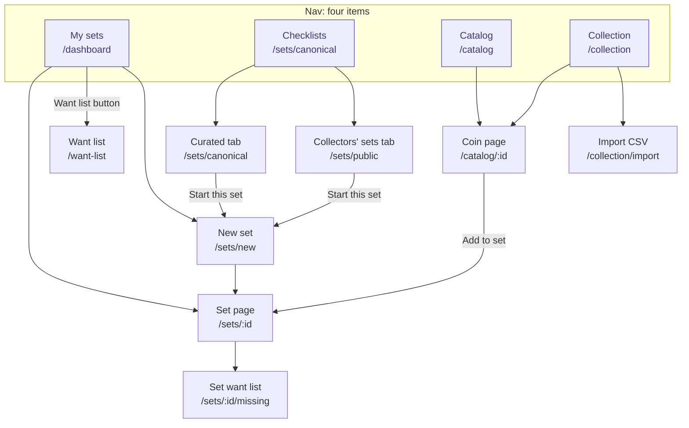
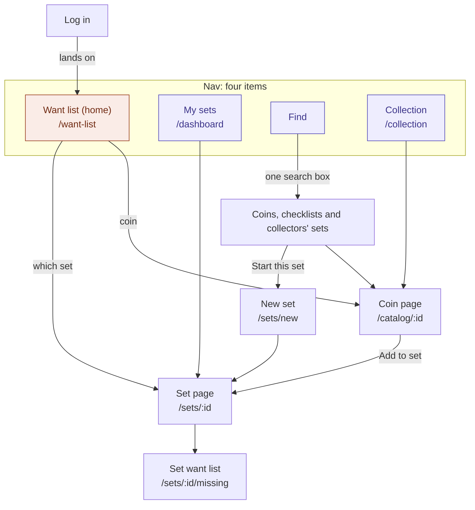

# Signed-in navigation (2026-11-25)

Two navigation designs for signed-in users, chosen after mapping today's flow in [docs/user-flow.md](../user-flow.md). That map showed that curated checklists, collectors' sets and the combined want list are hard to reach: none is in the nav, and the "Browse checklists" text link on My sets disappears when the user has no sets.

- **Option A, four tabs: chosen, build now.**
- **Option C, want list first: the direction for later.** Revisit once analytics show where returning users go first.

A third option was considered and not chosen: two nav items, "My collection" and "Browse", each with sub-tabs. It made the catalog two taps away.

## Option A: four tabs (build now)

The signed-in nav (desktop bar and phone tab bar) becomes **My sets · Checklists · Catalog · Collection**. Checklists holds the existing Curated and Collectors' sets tabs. The combined want list gets a clear button on My sets. No page moves.

What changes:

- The nav and the phone tab bar get a fourth signed-in item, **Checklists**, going to `/sets/canonical`.
- The active-item rule (`getActiveNavItem` in `apps/web/src/lib/site-nav.ts`) marks `/sets/canonical*` and `/sets/public*` as Checklists, not My sets. `/dashboard`, `/sets/new`, `/sets/:id` and `/want-list` stay My sets.
- My sets gets a visible **Want list** button next to New set, whenever the user has at least one set. The "Browse checklists" text links go, since the nav covers them.
- Glossary stays in the footer.

## Option C: want list first (later)

The product's main idea is "see what you're still missing", so a signed-in user lands on their **want list** and can quickly check whether they need a coin. Catalog, checklists and collectors' sets merge into one **Find** page with one search box.

Open questions before building C:

- **New users have an empty want list.** The home page needs its own first-run state, for example "Start your first checklist" with the curated checklists, until the user has a set.
- **"Do I need this coin?"** The quick check could be a search box on the want list itself: type "1914 D" and see at once whether it's missing, owned, or wanted in a better grade.
- **Find needs a combined search** across coins and sets. Today the catalog search and the checklist lists are separate.
- **Evidence first:** check in PostHog where returning users go after logging in before moving the home page.
