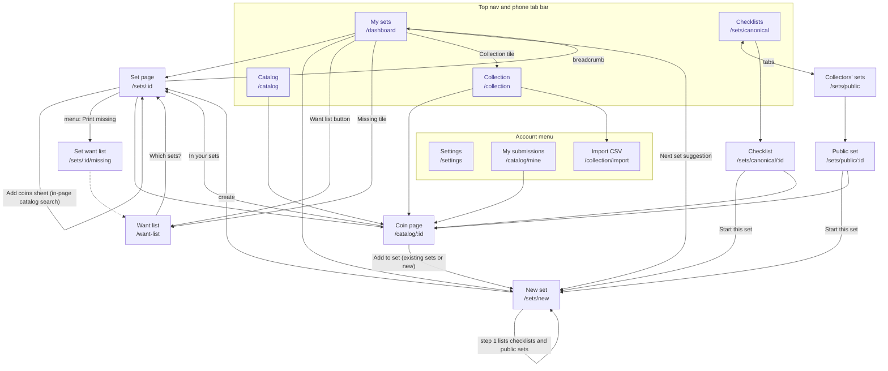
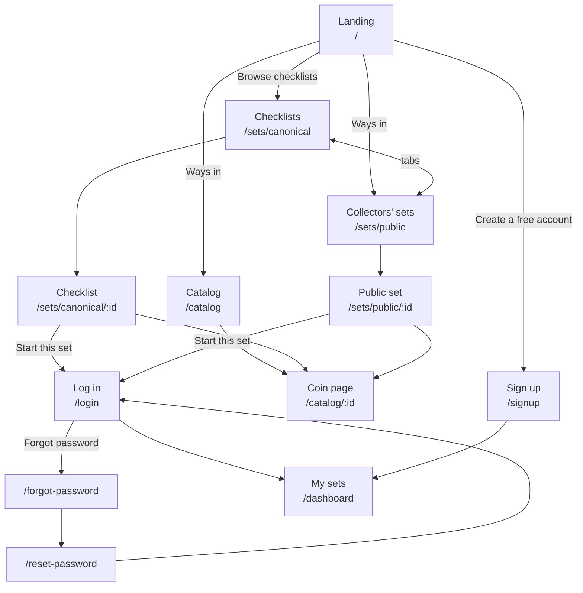

# User flow map

Drawn 2026-11-25 from the code, updated 2026-11-25 for navigation Option A: the routes under `apps/web/src/app`, the nav items in `components/layout/` (`site-nav.tsx`, `mobile-tab-bar.tsx`, `account-menu.tsx`, `site-footer.tsx`, `sets-tabs.tsx`) and every `href` / `router.push` in pages and components. Update it when navigation changes.

## Signed in

Nav (desktop bar and phone tab bar): My sets, Checklists, Catalog, Collection. Account menu: Settings, My submissions, Import from CSV (and Admin for admins). Footer: Glossary, Send feedback, Privacy.

## Signed out

Nav: Catalog, Checklists (`/sets`, which redirects to `/sets/canonical`), Log in, Create account. Phone tab bar: Catalog, Checklists, Glossary. `/` is the landing page; signed-in visitors are redirected from `/` to `/dashboard`.

## What the map shows

1. **Checklists and collectors' sets were not in the signed-in nav** (addressed 2026-11-25): Checklists is now a nav item and phone tab linking to `/sets/canonical`, reachable with or without sets; the "Browse checklists" text links on My sets are gone.
2. **On those pages the nav highlighted "My sets"** (addressed 2026-11-25): `getActiveNavItem` now marks `/sets/canonical*` and `/sets/public*` as Checklists; own sets, the new-set form and the want list stay under My sets.
3. **The combined want list had no clear entry** (addressed 2026-11-25): My sets has a secondary "Want list" button beside New set (beside "Your sets" on the phone) whenever the user has a set, besides the "missing" tile and the link on a set's want list.
4. **Catalog is in the nav, but nothing points to it from My sets or a set page.** From a set, coins are added through the Add coins sheet; the catalog page itself is only one hop away through the nav.
5. **Glossary is footer-only when signed in.**
